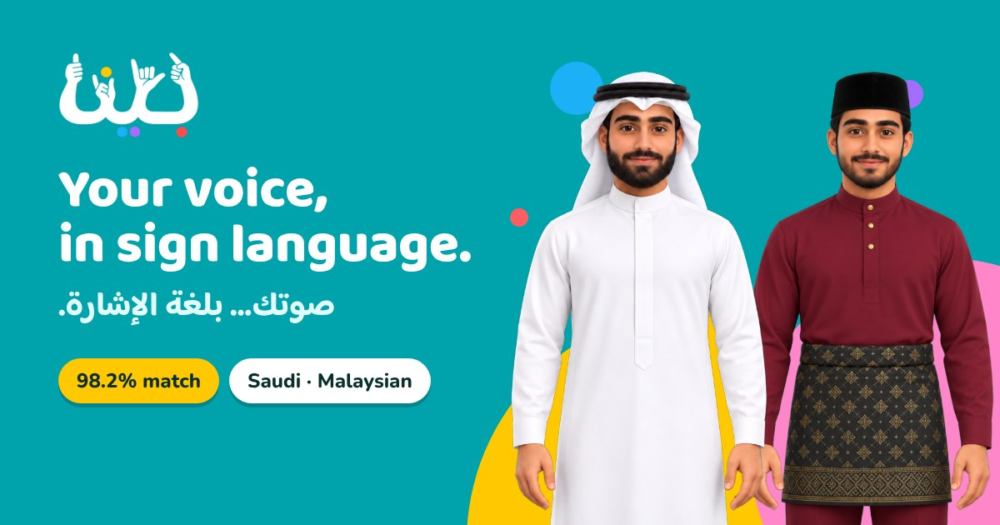

  

<h1 align="center">Bayyina · بيّنا</h1>

<b>Your voice, in sign language.</b> صوتك… بلغة الإشارة.

| | |
|---|---|
| Avatars | Saudi · Malaysian |
| Signs | 15 (5 Saudi Sign Language · 10 Malaysian Sign Language) |
| Average match | **98.2%** |
| Same-frame timing | 14 of 15 signs |

**Contact:** [khaled0wleed@gmail.com](mailto:khaled0wleed@gmail.com)

---

© 2026 Khaled Waleed Khamis Ba Tais. All rights reserved.
Original sign videos: MFD (Malaysia) and the Saudi Sign Language Dictionary, property of their respective owners.
